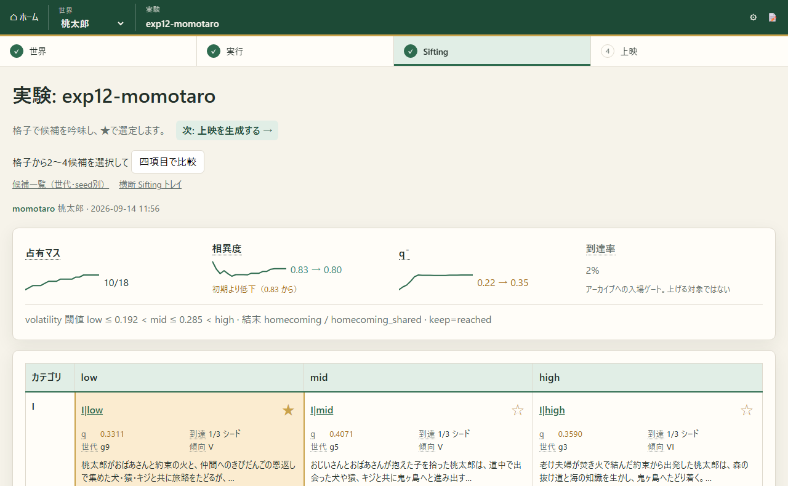

[日本語](README.md) | [English](README.en.md)

<div align="center">

# WorldBloom

**A fixed-ending story generation engine powered by genetic algorithms and LLMs**

[](LICENSE)
[](https://github.com/ATO-LABO/WorldBloom/releases/latest)

<a href="https://youtu.be/Yozi2qb2IQg"></a>

[](https://github.com/ATO-LABO/WorldBloom/releases/latest/download/WorldBloom-Studio-portable.zip)
[](https://ato-labo.github.io/WorldBloom/)
[](https://youtu.be/Yozi2qb2IQg)
[](https://ato-labo.github.io/WorldBloom/docs/en/)

</div>

## What is WorldBloom?

**Define the setting and ending first.** WorldBloom simulates thousands of paths between them, then lets you choose interesting developments from the runs that reached the ending.

In stories with a known ending, such as folktales, romances, or detective stories, much of the interest lies in the journey. WorldBloom searches for those journeys and turns only the selected paths into prose.

The Studio and viewer interfaces are currently in Japanese. English documentation is available through the links below; the linked ATOM-BOX background articles are in Japanese.

<p align="center">
  
</p>

## Creative philosophy

People, too, are natural phenomena within the world. Places, relationships, and time: define the world around the protagonist well enough, and the story begins to unfold naturally. Creating a story therefore means creating a world.

Human choices also emerge from a web of relationships and conditions, as explored by Spinoza, Sapolsky, and the Buddhist idea of dependent origination. WorldBloom is built from a position that rejects the existence of free will. Even so, its characters have freedom: the freedom to act according to their own nature, without being bent to an outside purpose, rather than to choose without a cause. This is the Daoist idea of *ziran*, or naturalness, associated with Laozi and Zhuangzi. When a character "starts moving on their own," they have gained that freedom. A contrived plot is the trace left when the author's intervention takes it away.

Meaning comes after events, an idea connected to predictive coding and active inference, Gazzaniga's "interpreter," and Bem's self-perception theory. WorldBloom therefore starts with a GA and simulation to produce actions within the world, then has an LLM interpret them as a story.

Read the full article: [WorldBloom's Creative Philosophy](https://www.atom-box.jp/worldbloom/philosophy/) (Japanese).

## How it works, in brief

Characters are represented by seven layers (ability, perception, resources, phase, identity, objective, and foreshadowing) plus vitality. The genome is a **strategy vector of 9 scalars**, rather than a sequence of actions. Simulations run with fixed seeds, and only those that reach the fixed ending are kept in a MAP-Elites grid (leading categories I–VI × volatility). **No LLM is involved in generating events.** A human reads the synopses in the grid and chooses which paths the LLM will turn into full prose.

WorldBloom extracts and rebuilds ideas from StorySim, another project by the same author that simulates worlds and characters and turns interesting logs into stories. It is not a fork.

For more detail, see [How WorldBloom Works](https://www.atom-box.jp/worldbloom/how-it-works/) (background article, Japanese) or the documentation's [Concepts](https://ato-labo.github.io/WorldBloom/docs/en/concepts/overview/) section: the overall flow, seven layers, genome, QD Map, fixed ending, action types, foreshadowing, Sifting, and determinism.

## What you can do

- **Explore and select in the QD grid (Sifting / Screening)**: choose paths from the leading-category × volatility grid and generate their synopses and prose.
- **World self-expansion**: have the system propose additions to the world from experiment results, approve or reject them, and compare results with and without the expansion.
- **Visualize lineage and turning points**: see in graphs how strategies change across generations and where the story takes a different turn.
- **Jev (rationality layer)**: check how plausible action choices are while adjusting the κ slider. This feature is under development.

For operational features such as GPU coordination and progress displays, see [Usage](https://ato-labo.github.io/WorldBloom/docs/en/usage/create-world/), including [GPU Guard](https://ato-labo.github.io/WorldBloom/docs/en/usage/gpu-guard/).

## Try it

**Detailed instructions: [Documentation](https://ato-labo.github.io/WorldBloom/docs/en/) ([Installation](https://ato-labo.github.io/WorldBloom/docs/en/getting-started/install/) / [Quickstart](https://ato-labo.github.io/WorldBloom/docs/en/getting-started/quickstart/)).**

- **A. Use the executable (Windows)**: extract [WorldBloom-Studio-portable.zip](https://github.com/ATO-LABO/WorldBloom/releases/latest/download/WorldBloom-Studio-portable.zip) and open `WorldBloom-Studio.exe`. You can choose a world, run GA experiments, sift through results, and generate synopses and prose. Running GA experiments also requires a separate installation of Python 3.12 or later and PyYAML.
- **B. Browse without installing anything**: the [Public Viewer](https://ato-labo.github.io/WorldBloom/) lets you read the grids, synopses, and prose from three experiments: Momotaro, romance, and detective fiction.
- **C. Run from source**: use `git clone`, then `pip install -r requirements.txt` (Python 3.12 or later). The [Installation](https://ato-labo.github.io/WorldBloom/docs/en/getting-started/install/) guide covers opening the bundled `samples/` in the viewer, running the GA yourself, and other setup steps.
  Regression testing covers Python 3.12 and 3.13 on Ubuntu and Windows.

See [Usage](https://ato-labo.github.io/WorldBloom/docs/en/usage/create-world/) for running evolution, regenerating synopses or prose, configuring LLM backends, and using GPU Guard. The [Reference](https://ato-labo.github.io/WorldBloom/docs/en/reference/cli/) covers command arguments and all settings.json fields. For help with problems, see [Troubleshooting](https://ato-labo.github.io/WorldBloom/docs/en/guides/troubleshooting/). Developer information, including regression tests and the determinism contract, is in [docs/DEVELOPMENT.md](docs/DEVELOPMENT.md) (Japanese).

## Read more

### Documentation: guides and reference

The documentation site covers installation, configuration, commands, and file formats in [English](https://ato-labo.github.io/WorldBloom/docs/en/) and [Japanese](https://ato-labo.github.io/WorldBloom/docs/).

- [Getting Started](https://ato-labo.github.io/WorldBloom/docs/en/): overview, [Installation](https://ato-labo.github.io/WorldBloom/docs/en/getting-started/install/), and [Quickstart: one full cycle with Momotaro](https://ato-labo.github.io/WorldBloom/docs/en/getting-started/quickstart/)
- [Concepts](https://ato-labo.github.io/WorldBloom/docs/en/concepts/overview/): overall flow, seven layers, genome, QD Map, fixed ending, action types, foreshadowing, Sifting, and determinism
- [Usage](https://ato-labo.github.io/WorldBloom/docs/en/usage/create-world/): creating a world, run settings, reading results, text generation, ⚙ Settings, LLM backends, GPU Guard, and CLI
- [Reference](https://ato-labo.github.io/WorldBloom/docs/en/reference/cli/): CLI, settings.json, template formats, run-output files, HTTP API, and [Glossary](https://ato-labo.github.io/WorldBloom/docs/en/reference/glossary/)
- [Troubleshooting](https://ato-labo.github.io/WorldBloom/docs/en/guides/troubleshooting/)

### Background articles on ATOM-BOX (Japanese)

The official site has articles about the mechanisms and ideas behind WorldBloom. They are a useful starting point before reading the code.

- [WorldBloom Hub](https://www.atom-box.jp/worldbloom/): overview, features, and downloads
- [WorldBloom's Creative Philosophy](https://www.atom-box.jp/worldbloom/philosophy/): creating a story means creating a world; meaning comes after action
- [How WorldBloom Works](https://www.atom-box.jp/worldbloom/how-it-works/): seven layers, genome, fixed ending, QD Map, and output
- [Try WorldBloom](https://www.atom-box.jp/worldbloom/get-started/): Studio, the Public Viewer, and running from source
- [Why Combine a GA and an LLM?](https://www.atom-box.jp/worldbloom/ga-and-llm/): their respective strengths and weaknesses, and the reasons for dividing their roles
- [WorldBloom in Story Generation Research](https://www.atom-box.jp/worldbloom/background/): connections to Tale-Spin, evolutionary generation, MAP-Elites, and LLM-based long-form generation, with references
- [Generated Example: Momotaro](https://www.atom-box.jp/worldbloom/example-momotaro/): the grid, synopses, and prose from the bundled exp12 sample
- [Glossary](https://www.atom-box.jp/worldbloom/glossary/): definitions of terms used in the interface and explanations

### Developer documents (Japanese, in docs/)

- Developer guide (regression tests, determinism contract, executable builds, and documentation updates): [docs/DEVELOPMENT.md](docs/DEVELOPMENT.md)
- Detailed design: [docs/2026-09-11_gapengine-detailed-design.md](docs/2026-09-11_gapengine-detailed-design.md)
- Viewer UI/UX design: [docs/2026-09-12_viewer-ux-design.md](docs/2026-09-12_viewer-ux-design.md)

## Repository layout

```
engine/      Seven-layer characters, world, verbs, confrontation resolution, predicate evaluation, vitality, logs
gapengine/   Genome, Policy, classifier, precedent table, QD, evolution loop, synopses, explanation extraction
execution/   Settings, jobs, and permission boundaries for managing evolution/output jobs from the viewer
viewer/      HTTP viewer (standard library only): grid, synopses, prose, and run management
scripts/     Scripts for evolution, synopses, narration, random baselines, static publishing, sample packing, etc.
templates/   Genre templates: action graphs, modulation rules, canon priors, QD axes, foreshadowing libraries
projects/    Initial world and character states (seven layers): momotaro / detective / romance
samples/     Minimal viewer-ready samples (three experiments, generated by scripts/pack_samples.py)
tests/       Regression tests (unittest)
docs/        Design documents, implementation plans, and disclosures
docsite/     Documentation sources (Japanese/English, MkDocs), published automatically on pushes to main
```

Run outputs belong outside the repository by default; specify their location with `--out`. The `samples/` directory is an exception, included in the repository for distribution.

## License and author

[Apache License 2.0](LICENSE). Copyright 2026 ATO-LABO.

Developed by ATO-LABO (Tomoya Akiyama). For technical questions or collaboration inquiries, use [ATOM-BOX Contact](https://www.atom-box.jp/contact/).
